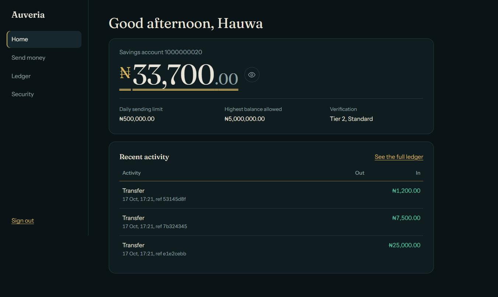
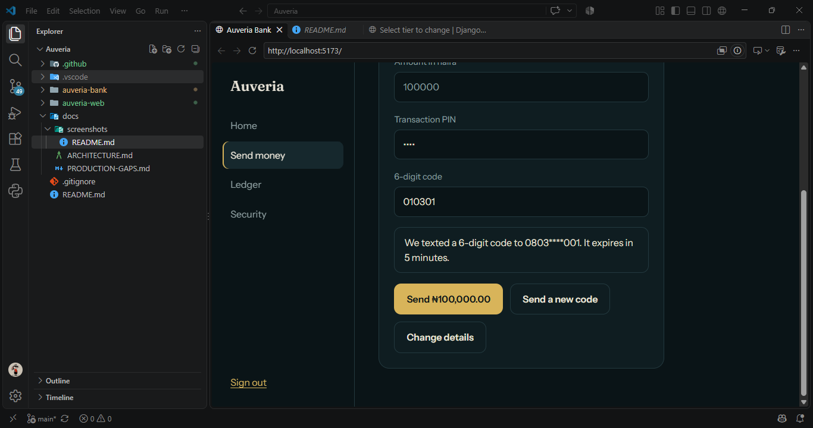

# Auveria Bank

A Nigeria-first core banking system, built end to end as a portfolio project: a Django backend with a
double-entry ledger, a REST API, and a React + TypeScript customer app and teller desk.

> **This is a portfolio project, not a licensed bank.** Auveria is fictional, identity checks and SMS are mocked,
> and the bank code and some limits are placeholders. See [docs/PRODUCTION-GAPS.md](docs/PRODUCTION-GAPS.md) for
> an honest list of what a real deployment would still need.



## What it does

- **Open an account** with BVN and NIN verification, tiered KYC limits, and an auto-generated 10-digit NUBAN.
- **Move money** between accounts with name enquiry, a transaction PIN, and an SMS code for larger transfers.
- **Keep honest books.** Every movement is a pair of immutable ledger entries, and a `reconcile` command proves
  that the books balance.
- **Run a cash desk.** Tellers look up accounts and record deposits and withdrawals through a cash vault, with
  a journal of cash movements.
- **Stay private.** Balances can be hidden with one click, and full BVN/NIN numbers are never stored.

| Customer app | Teller desk |
| --- | --- |
|  |  |

## Design decisions worth a look

| Decision | Why |
| --- | --- |
| Money is integer **kobo** everywhere, formatted only at the edges | Floats lose pennies. Integers can't. |
| **Double-entry ledger**, entries immutable, mistakes fixed by reversal | The history is the truth; balances are derived and cached. |
| `transfer()` is **atomic**, locks rows in a fixed order, and re-checks funds under the lock | No overdrafts or deadlocks under parallel requests (tested on PostgreSQL). |
| **Idempotency keys** on every money-moving request, checked after locking | Retried or duplicated requests can't pay twice. |
| **OTP bound to the exact transfer** (accounts and amount) | A code stolen for one transfer is useless for another. |
| **PIN lockout** and OTP attempt limits, with attempts counted even when a request fails | Guessing doesn't scale. |
| BVN/NIN stored only as **last 4 digits plus a keyed hash** | Duplicate detection without holding the sensitive numbers. |
| **Provider interfaces** for identity checks and SMS, with mock implementations | A real BVN/NIN or SMS gateway is one class and one setting away. |
| `reconcile` checks every transaction balances, every cached balance matches the ledger, and all balances sum to zero | The books can audit themselves. |

More detail, with diagrams, in [docs/ARCHITECTURE.md](docs/ARCHITECTURE.md).

## Stack

- **Backend:** Python, Django, Django REST Framework, PostgreSQL (SQLite works for local development)
- **Frontend:** React, TypeScript, Vite (no UI framework; hand-written CSS)
- **Testing:** Django's test runner, including multi-threaded concurrency tests that need PostgreSQL

## Run it locally

You need Python 3.12+ and Node.js 20+. PostgreSQL is optional.

```bash
# 1. Backend
cd auveria-bank
python -m venv .venv
# Windows PowerShell: .\.venv\Scripts\Activate.ps1      macOS/Linux: source .venv/bin/activate
python -m pip install -r requirements.txt
python manage.py migrate
python manage.py seed_demo          # two demo customers with funds and history
python manage.py createsuperuser    # a staff login for the teller desk
python manage.py runserver

# 2. Frontend (a second terminal)
cd auveria-web
npm install
npm run dev
```

Open http://localhost:5173. Demo customers sign in with phone `08030000001` or `08030000002`, password
`Demo-Passw0rd!`, and PIN `2580`. Staff sign in with their username. In development, the SMS code is printed in the
backend terminal.

### Tests

```bash
cd auveria-bank
python manage.py test            # the concurrency tests are skipped on SQLite
python manage.py reconcile       # "Reconciliation OK" means the books balance
```

To run the concurrency tests, point Django at PostgreSQL first by setting `DB_NAME`, `DB_USER` and
`DB_PASSWORD` (see `auveria-bank/README.md`).

## Repository layout

```
auveria-bank/    Django project
  apps/kyc/        customers, tiers, identity checks, PIN
  apps/accounts/   accounts, NUBAN generation
  apps/ledger/     double-entry ledger, deposits, withdrawals, reconciliation
  apps/security/   one-time codes and the SMS provider seam
  apps/api/        REST API (auth, transfers, statements, teller endpoints)
auveria-web/     React + TypeScript app (customer app and teller desk)
docs/            architecture, production gaps, screenshots
```

## Nigeria-specific details

- **NUBAN** account numbers: a 9-digit serial plus a check digit computed from the bank code.
- **BVN and NIN** onboarding, with KYC tiers that cap daily sending and maximum balance.
- **Amounts in naira** (₦), stored as kobo.
- Tier limits beyond Tier 1 and the bank code `777` are **placeholders**. Verify them against current CBN
  guidance before treating any number here as real.
