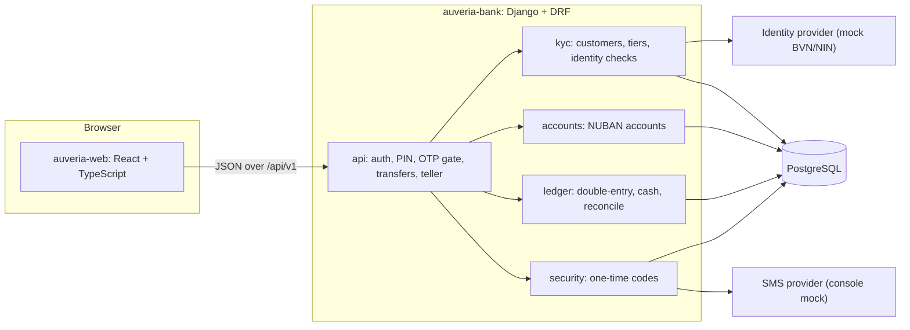
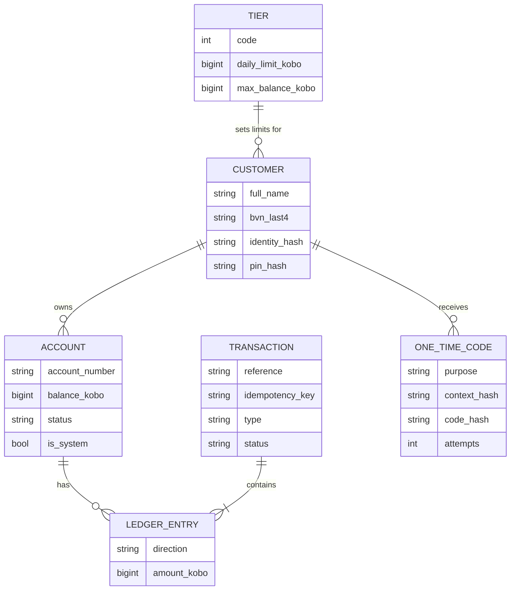
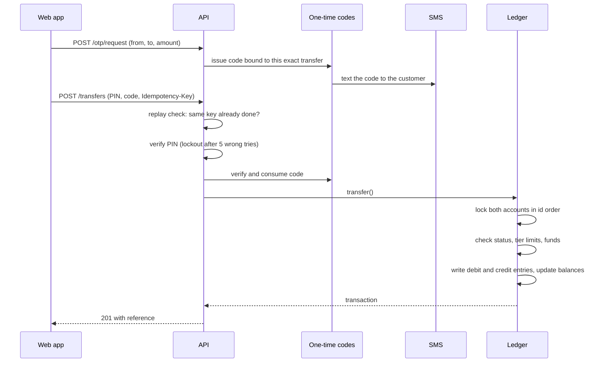

# Architecture

## Components

The browser only talks to the API. In development, Vite proxies `/api` to Django, so no CORS configuration is
needed. The identity and SMS providers sit behind small interfaces (`apps/kyc/providers.py`,
`apps/security/providers.py`) and are selected by settings.

## Data model

`Account.balance_kobo` is a cache. The ledger is the source of truth, and `reconcile` checks the two agree.
The **cash vault** is a system account: deposits debit it and withdrawals credit it, so it runs negative by exactly
the net cash customers have handed in. Because every transaction balances, the sum of all account balances is
always zero.

## A large transfer, step by step

Transfers below the OTP threshold skip the code steps. A retry with the same `Idempotency-Key` returns the
original result without asking for a new PIN or code.

## Guarantees and how they're enforced

| Guarantee | Mechanism | Tested by |
| --- | --- | --- |
| Entries per transaction sum to zero | `transfer()` always writes one debit and one credit | `reconcile` plus ledger tests |
| Ledger entries can't be edited | `save()` and `delete()` raise on existing entries; read-only admin | `test_ledger_entries_are_immutable` |
| No overdraft under parallel requests | Row locks (`SELECT ... FOR UPDATE`) and a funds check under the lock | `ConcurrencyTests` (PostgreSQL) |
| No double charge on retries | Unique idempotency key, checked after locking | API and concurrency tests |
| No deadlocks between opposite transfers | Locks always taken in account-id order | opposite-direction concurrency test |
| Limits can't be raced | Daily total is read after the sender's row is locked | parallel daily-limit test |
| A code can't approve a different transfer | The code carries a hash of (from, to, amount) | OTP service and API tests |

## Project conventions

- Amounts are integer kobo in the database, the API (`amount_kobo`) and the frontend. `₦` formatting happens in
  `apps/accounts/money.py` and `auveria-web/src/money.ts` only.
- Staff and customers share one login endpoint. `GET /api/v1/whoami/` tells the app which interface to show.
- Settings hold everything environment-specific: bank name and code, KYC tiers, provider classes, OTP limits.
